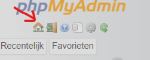

wat hebben we gemaakt 
hoe werkt het
hoe hebben we het gemaakt
wat heb je nodig:
XAMPP
visual studio code of een andere code editor.

hoe kan je het opstarten:
download alle files, dowload en open XAMPP, start apache en mysql, druk bij mysql op admin en druk dan op de huisje . dan moet je naar de sql knop in de navbar en zet je de hele sql file in. dan druk je op de start knop wat iets onder de plek staat waar je net de sql in hebt gevoerd. je gaat terug naar xampp en drukt op admin bij apache. zet alle files die je eerder hebt gedownload in een map genaamd project_week. typ in de search bar op een browser na keuze deze link http://project_week/project-week/index.php . je zit dan nu op de website.

wat kan je doen op de website:
    reservaties:
    als je op de knop reservatie drukt die in de navbar staat kan je naar de reservatie pagina gaan waar je zelf een reservatie kan maken bij de restaurants die zijn geregistreert. als je eenmaal een reservatie hebt gemaakt wordt je gelijk naar het reservatie overzocht gestuurdt waar u uw net gemaakte reservatie kan zien. u zou deze ook kunnen aanpassen op de edit knop die rechts van de reservatie staat van de reservatie. uw zou hier ook de reservatie kunnen verwijderen met de delete knop.

    restaurants:
    als je op de restaurant overzicht knop drukt op de navbar ga je naar het overzicht waar alle actieve restaurants staan. als je op de restaurant overzicht bent is er een nieuwe knop verschenen en als je op die knop drukt kan je een restaurant registreren.(W.I.P)